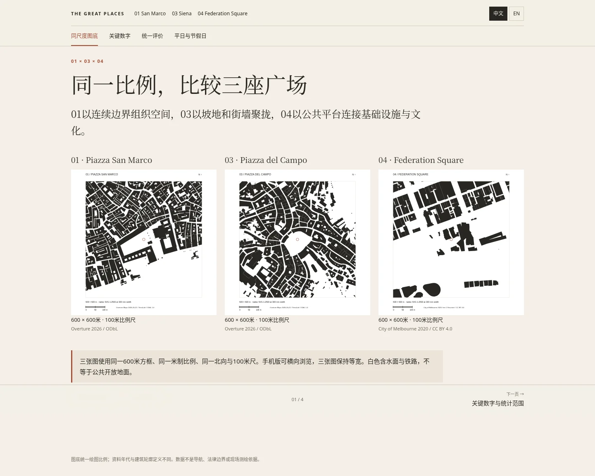

# 01／03／04统一阅读器：完成度审核与实测

核查日期：2026-11-13。分支 `improve/unified-case-reader`。本次包含先前PR #5的04研究成果，并统一01、03、04。main生产网页尚未合并更新。

## 更新网页

以下为固定到实际测试代码 `21eb083e6181b43325fbb83fd5f5ea26f82d6ba2` 的第三方分支预览；并非main生产站。

- [01 Piazza San Marco](https://htmlpreview.github.io/?https://github.com/cloudyli2026/great-places/blob/21eb083e6181b43325fbb83fd5f5ea26f82d6ba2/docs/index.html)
- [03 Piazza del Campo](https://htmlpreview.github.io/?https://github.com/cloudyli2026/great-places/blob/21eb083e6181b43325fbb83fd5f5ea26f82d6ba2/docs/cases/piazza-del-campo.html)
- [04 Federation Square](https://htmlpreview.github.io/?https://github.com/cloudyli2026/great-places/blob/21eb083e6181b43325fbb83fd5f5ea26f82d6ba2/docs/cases/federation-square.html)
- [三案并排比较：同尺度图底、数字、评价、平日与节假日](https://htmlpreview.github.io/?https://github.com/cloudyli2026/great-places/blob/21eb083e6181b43325fbb83fd5f5ea26f82d6ba2/docs/comparison.html)

## 以01为基准的逐项审核表

“已统一”表示内容结构与网页功能完成；“注明缺口”表示未找到可靠证据，未用推测填空。

| 核查项 | 01 San Marco | 03 Campo | 04 Federation Square |
|---|---|---|---|
| 页面展开 | 同一8章／17分页；每次仅显示当前页 | 相同 | 相同，已移除连续长页 |
| 导航与交互 | 同一章内标签、前后页、历史记录、图片放大 | 相同 | 相同 |
| 字体、排版、手机端 | 共用CSS／JS，版本1b4d1562241d | 相同 | 相同 |
| 中英文 | 正文、图注、数字口径、导航切换；语言记忆 | 相同 | 相同 |
| 地图 | Google实况地图＋Google／OSM打开链接 | 相同 | 已补齐，浏览器实际显示 |
| Figure Ground | 600×600m；原生300mm SVG为1:2500；100m尺 | 相同 | 相同，官方2020建筑轮廓 |
| 原始GIS记录 | Overture 490条；框内487多边形 | Overture 428条；框内426多边形 | 官方907条Structure；框内119多边形 |
| 图幅建筑覆盖率 | 49.58% | 54.98% | 28.97% |
| 平面与剖面直接显示 | 保留既有图纸；原始出版元数据部分欠缺，已注明 | 补入2025 TU Wien论文的真实平面／横纵剖面摘图 | 原设计总图、复合平面、城市／建筑／平台剖面；非概念重绘 |
| 坡地展示 | 依现有真实剖面阅读 | 横纵剖面清楚显示向市政宫汇聚的坡面 | 原城市剖面局部直接显示；遗产文件记载西向东约6m抬升 |
| 立面、街道、公共空间 | 立面、柱廊、水岸、咖啡外摆 | 市政宫、环绕街墙、街巷入口、坐卧坡面 | 鸟瞰、北／南／铁路侧／广场内侧照片、Atrium入口及内部 |
| 日常与活动 | 日常功能、2018活动限额与三种日历状态 | 日常停留、Palio照片和布置变化 | 日常坐靠／穿行、夜间活动、2015节庆、2003公共集会 |
| 所在城市人口 | 251,294，2025年底全市镇 | 53,588，2025年底全市镇 | 194,481，2025年6月City of Melbourne LGA；大都会数字另列 |
| 气候条件与适应 | 城市降水、潮汐；柱廊与积水限制 | 1961–90气候、785.7mm年雨量；少遮荫与雨天活动限制 | 历史气温、风雨、Atrium／Labyrinth；不推定全年舒适 |
| 公共交通 | ACTV水上巴士＋步行 | 公交／铁路抵达城市，末段步行 | Flinders Street火车、电车、免费电车区 |
| 景观、商业、科技 | 同一维度，来源与局限明确 | 相同 | 相同；河岸、Test Garden、数字屏、被动系统分别说明 |
| 社区／旅游 | BOTH，旅游导向 | BOTH，Contrade与旅游 | BOTH，文化机构、社区活动与游客 |
| 平日／普通节假日／重大活动 | 三列同口径功能比较；无人流增长倍数 | 相同 | 相同 |
| 活动容量 | 20,000，仅2018特定活动 | 约15,000，仅2026 Palio中心站席区、安保方报告 | 10,000，当前Main Square场地列表 |
| 广场级年到访量 | 未取得可靠完整统计，null | 相同，null | 2025–26财年11.9M+；不宣称去重人数 |
| 活动定量补充 | 不虚构年度总数 | 每年两场常规Palio，非全年活动总数 | 年报389项活动、37项社区／文化活动、支持114个社区组织 |
| 统一评价维度 | 同一10项，无虚构分数 | 相同 | 相同 |
| 最突出的三个特点 | 连续柱廊；广场—水岸序列；仪式与日常共用 | 可坐卧的坡地；街巷收束与展开；社区仪式延续 | 基础设施上的公共地面；室内外互补；文化与数字活动平台 |
| 研究过程与文献 | 移至折叠资料页；正文结论优先 | 相同 | 相同，无单独气候章节 |
| 空间句法 | 地图与图纸支持的形态解读；无正式计算数值 | 相同 | 相同，不伪造轴线图、整合度或选择度 |
| 一页PDF档案 | 已实际导出1页 | 相同 | 相同 |

图底同尺度不表示数据同年代。白色包含水面、铁路及其他非建筑地面，不能作为公共开放率。面积、活动容量与年到访量使用不同的明确边界，不能直接换算人数密度或质量排名。容量不是所有年份与布置通用的法定最大值。

## 实际测试结果

- **本地1538项通过，0失败，0页面脚本错误。** [机器记录](browser-results.json)
- **固定提交线上预览1538项通过，0失败，0页面脚本错误。** [机器记录](remote-browser-results.json)
- 真实Chromium／Playwright；1440×1000桌面、390×844手机、320×740窄屏；三案17页×两种语言。不是源码静态推断。
- 浏览器实际解码50处图像，包括SVG引用的原剖面图和折叠资料内图纸；不是仅检查HTTP 200。
- 9次地图检查均取得实际Google地图版权／地图数据内容；桌面、手机截图留档。
- 实际点击全部下一页与上一页、浏览器后退、旧锚点、图片放大及Escape焦点恢复；语言持久化与无整页横向溢出。
- 并排比较图在桌面和手机保持三张等宽；手机横滑阅读，不分别缩放。
- 实际跨案例点击01→03→04→01，显示正确案例。[导航记录](navigation-results.json)
- 导出并核对三份A4横向PDF均1页：[01](01-factsheet.pdf) · [03](03-factsheet.pdf) · [04](04-factsheet.pdf)。
- 174处本地引用及锚点有效；75个外部URL均返回200，图片MIME及PDF文件头验证通过。**其中8个威尼斯市政府HTML在直接GET下返回访问验证页，不能以200视为正文验证。** 已经独立网页读取核对标题与正文，仍单独保留访问限制记录：[链接结果](link-results.json) · [限制记录](source-challenges.json)。
- 同尺度GIS独立检查：100m地理测地线向四个方向投影，误差小于1mm；三案均符合600m框、100m尺、1:2500原生SVG。10个输出可确定性重建。[检查记录](integrity-results.txt)
- 原官方墨尔本907条Structure保留检查，1001条tier-1记录完整分页，排除94条Bridge，保留28个洞环；离线重建一致。[记录](official-gis-results.txt)

首轮线上比较页检查曾在预览器注入网页前读取加载画面；测试加入等待真实阅读器后，完整回归重跑通过。此处列的是最终通过记录。Chromium只信任当前受管环境代理CA的SPKI，没有全局关闭证书校验。

## 桌面与手机截图

[三案同尺度图底](comparison-desktop-figure-ground.webp) · [手机定量比较表](comparison-mobile-metrics.webp) · [01手机概况](01-mobile-intro.webp) · [03手机坡地剖面](03-mobile-section.webp) · [04桌面概况](04-desktop-intro.webp) · [04桌面剖面](04-desktop-section.webp) · [04手机地图](04-mobile-map.webp) · [04手机三特点](04-mobile-conclusion.webp)

## 数据与来源入口

[统一术语、编译与核查方法](../../../cases/reader/README.md) · [定量JSON](../../data/case-comparison.json) · [CSV](../../data/case-comparison.csv) · [同尺度参数与源文件SHA256](../../data/comparison-figures.json) · [Siena原图摘录出处与PDF页码](../../drawings/sources.json)

01与03建筑数据由TerraLab从Overture Maps 2026-10-21提取，分别490与428条，未截断；来源、ODbL及上游归属和下载元数据保存在[san-marco](../../data/san-marco-comparison-source.json)和[siena](../../data/siena-comparison-source.json)。冻结GeoJSON：[01](../../data/san-marco-comparison-buildings.geojson) · [03](../../data/siena-comparison-buildings.geojson)。04为City of Melbourne 2020、CC BY 4.0：[官方轮廓子集](../../data/federation-buildings.json)。数据供建筑研究，不是现场测绘、导航或法律边界依据。

仍未取得：三案同口径连续平日／节假日人流、01／03广场级年到访量、正式空间句法模型与计算、04完整校准正投影立面组。相应页面明确注明，照片不冒充正投影测绘图；已有01图像的部分历史出版元数据也没有伪造补齐。
