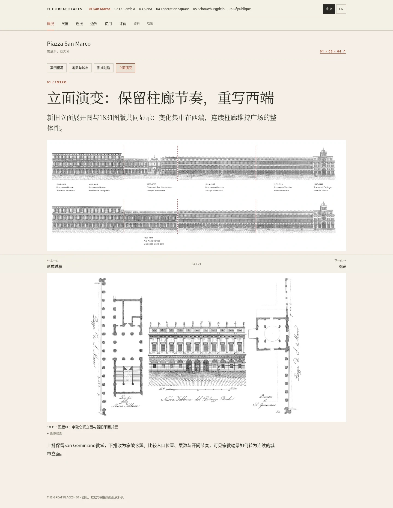
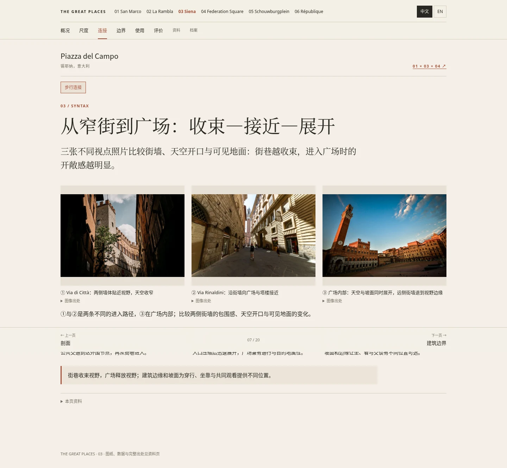

# 历史图纸、公共活动与庆典图集补回审核

2026-11-13。此轮接续PR #6，修复统一模板遗漏旧内容、03重复照片和活动介绍不足的问题。保持同一8章、同一分页与中英切换；01有21小页，03／04各20小页。内容深度不再受强制相同页数限制。

## 更新网页

固定到实际线上测试的页面代码 `d68ee78d73cc71e7d5d61dec9922ab128d3a5e24`。仍为分支预览，未合并main。

- [01：历史平面演变](https://htmlpreview.github.io/?https://github.com/cloudyli2026/great-places/blob/d68ee78d73cc71e7d5d61dec9922ab128d3a5e24/docs/index.html#history) · [立面演变](https://htmlpreview.github.io/?https://github.com/cloudyli2026/great-places/blob/d68ee78d73cc71e7d5d61dec9922ab128d3a5e24/docs/index.html#history-elevation)
- [03：窄街巷与开敞广场对照](https://htmlpreview.github.io/?https://github.com/cloudyli2026/great-places/blob/d68ee78d73cc71e7d5d61dec9922ab128d3a5e24/docs/cases/piazza-del-campo.html#syntax)
- [01重要事件年表](https://htmlpreview.github.io/?https://github.com/cloudyli2026/great-places/blob/d68ee78d73cc71e7d5d61dec9922ab128d3a5e24/docs/index.html#milestones)
- [03重要事件年表](https://htmlpreview.github.io/?https://github.com/cloudyli2026/great-places/blob/d68ee78d73cc71e7d5d61dec9922ab128d3a5e24/docs/cases/piazza-del-campo.html#milestones)
- [04重要事件年表](https://htmlpreview.github.io/?https://github.com/cloudyli2026/great-places/blob/d68ee78d73cc71e7d5d61dec9922ab128d3a5e24/docs/cases/federation-square.html#milestones)

各案“使用”章还可打开“公共活动”和“节日庆典”：图片与文字成组说明活动内容、参与方式、日期及场地变化。

## 内容恢复与新增

| 项目 | 本轮结果 | 直接显示与核查 |
|---|---|---|
| 01历史平面 | 补回1689 Robert de Cotte原图、1831 Quadri／Moretti图版I | 公共领域缩略图冻结本地；保留原图方向与比例，点击放大 |
| 01西端改造 | 补回1831图版IX，新旧平面与拿破仑翼立面并置 | 主阅读器单独“立面演变”页，非仅资料链接 |
| 01立面分期 | 补回Chipperfield发布的广场展开立面，上排教堂／下排拿破仑翼 | 直接渲染原PDF图纸；网页只裁去空白，放大看完整原页 |
| 01剖面、立面补充 | Procuratie南立面、横剖面；原有两张总督宫研究图恢复阅读入口 | 图纸直接可见；总督宫图组保留折叠阅读，作者／出版缺口注明 |
| 01尺寸证据 | 钟楼98.6m、12×12m基座；Generali修复项目152m、43／50拱券、约12,400m² | 明确钟楼总高、项目范围与檐口高度的不同；不推算H/W |
| 03旧节庆照片 | 2007 Palio赛前人群、Carabinieri骑兵仪式、Oca街巷游行 | 三张原有照片恢复；署名与许可逐图链接 |
| 03图注纠错 | Carabinieri照片为赛前仪式，而非Palio正赛 | 不沿用旧版错误“赛马场景”标注 |
| 03照片去重 | 去掉跨页重复和不同资产键共用同图 | 14张正文照片URL不同；像素归一化哈希／差异哈希未发现重复或近重复 |
| 03街巷尺度对比 | Via di Città、Via Rinaldini与地面视点的Campo三图 | 分别说明墙体包围、天空开口和坡面展开；不是伪造同一路线测量 |
| 03音乐与市场 | 2025-07-18交响音乐会现场照、往届Mercato集市照 | 音乐会注明免费预约；2026集市为计划日期，配图不冒称尚未发生的2026现场 |
| 01公共／庆典 | La Fenice户外歌剧、日常公共使用、Carnevale开幕、Festa delle Marie | 增加音乐会现场、夜间开幕全景及典礼舞台照片 |
| 04公共／庆典 | 户外电影与集体观看、和平集会、Diwali、Polish Festival | 舞台实景可见；官方宽图中央照片在网页聚焦，放大仍为完整原图 |
| 三案重要事件 | 各案新增事件年表，日期、类型、事件意义、来源、相关图像入口 | 区分现场活动、转播观看、历史事件与未来公告 |
| 文本与图像关系 | 活动记录按内容／参与／空间变化组织，图注指出观看重点 | 正文不以研究过程叙述代替结论；方法限制留在资料页 |

## 三案重要事件清单

| 案例 | 日期 | 事件 | 场地角色／来源 |
|---|---|---|---|
| 01 | 1807–1814 | San Geminiano拆除与拿破仑翼重建 | 西端空间改造；原设计项目历史立面图 |
| 01 | 1902-07-14 | 圣马可钟楼倒塌 | 地标消失与重建问题；[大教堂官方史料](https://www.basilicasanmarco.it/en/bell-tower/) |
| 01 | 1912-04-25 | 重建钟楼揭幕 | 圣马可节城市典礼；同上 |
| 01 | 1966-11-04 | 特大潮水，市级潮位读数194cm | 不是各处水深；[市政府潮位记录](https://www.comune.venezia.it/it/content/valori-caratteristici-marea-venezia-il-periodo-1872-2015) |
| 01 | 2025-02-14 | 狂欢节开幕 | 西端舞台与公共聚集；[主办方记录](https://carnevale.venezia.it/news/2025/da-piazza-san-marco-ha-preso-il-via-il-carnevale-2025-il-tempo-di-casanova/) |
| 01 | 2025-07-12 | La Fenice《乡村骑士》音乐会版 | 广场临时舞台与售票座席；[剧院记录](https://www.teatrolafenice.it/event/la-fenice-in-piazza-san-marco-2025/) |
| 03 | 1944年7月 | 解放后欢迎de Monsabert及盟军来访者 | Campo作为共同庆祝场所；[文化部／国家档案馆](https://cultura.gov.it/evento/mostra-fotografica-luglio-1944-nel-campo-ottantanni-fa-la-liberazione-di-siena-e-delle-sue-terre-a-cura-di-luca-betti) |
| 03 | 1945-08-20 | Palio della Pace | 战后特别Palio，也有争议；[市政府Palio史料](https://palio.comune.siena.it/node/5780) |
| 03 | 2024-04-25 | 解放日官方典礼 | 广场公共纪念仪式；[当地现场报道](https://www.radiosienatv.it/25-aprile-le-celebrazioni-a-siena/) |
| 03 | 2025-07-18 | Concerto per l’Italia | RAI乐团、James Conlon、Lilya Zilberstein；[Chigiana主办方](https://www.chigiana.org/concerto-per-l-italia/) |
| 03 | 2026-07-03 | 七月Palio | 具体场次的入口／站席区管理；[现场安保方记录](https://nkmservice.com/sicurezza/grandi-eventi-e-concerti/gestione-flussi-e-safety-al-palio-di-siena/) |
| 04 | 2002-10-26 | Fed Square向公众开放 | 新公共地面开放；[运营方周年记录](https://fedsquare.com/events/20th-anniversary) |
| 04 | 2003 | 和平集会 | 广场内公共表达；[州立图书馆图像记录](https://blogs.slv.vic.gov.au/our-stories/federation-square-a-brief-history/) |
| 04 | 2008 | 全国道歉公共转播观看 | 典礼在堪培拉，广场是观看点；[遗产委员会决定PDF第24页](https://assets.heritagecouncil.vic.gov.au/assets/Determination-Federation-Square-FINAL.pdf#page=24) |
| 04 | 2010-06-04起 | Solar Equation／The Light in Winter | 可互动的公共艺术；[NASA项目记录](https://soho.nascom.nasa.gov/outreach/past/Equation/) |
| 04 | 2025-11-16 | Polish Festival | 免费社区文化庆典；[运营方活动记录](https://fedsquare.com/events/polish-festival) |
| 04 | 2026-10-31 | Victorian Festival of Diwali | 多场地社区节庆；[运营方活动记录](https://fedsquare.com/events/diwali) |

以上是可核实的代表事件，不声称穷尽全部历史，也不把照片年份不明的宣传配图当成某年特定场次的现场证据。

## 实际检查

最终本地与线上结果、来源访问检查及图片去重记录见本目录的`restoration/`文件夹。运行命令与共享机制见[内容契约](../../../cases/reader/README.md)。

- **本地1823项通过；固定提交线上预览1823项通过；两者均0失败、0页面脚本错误。** [本地记录](restoration/browser-results.json) · [线上记录](restoration/remote-browser-results.json)
- 1440×1000、390×844、320×740三种宽度；两种语言、三案全部分页、图片放大、前后页、浏览器后退、实际Google地图和打印均检查。
- 65处图像／图纸由浏览器实际解码，包括本地历史图版、原PDF渲染图及SVG图像引用。
- [03图片像素去重记录](restoration/siena-photo-audit.json)：14张正文照片，URL、归一化像素哈希与差异哈希检查通过，无重复或近似重复。
- [211处本地引用／117个外部URL检查](restoration/link-results.json)均有效；8个威尼斯自动访问验证页仍明确标记，未把200当作正文验证。
- [共享结构与同尺度图底可确定性重建](restoration/integrity-results.txt)通过。三张新Procuratie图纸也从SHA256校验的原始PDF重建，并确认生成字节一致。
- [01 PDF](restoration/01-factsheet.pdf) · [03 PDF](restoration/03-factsheet.pdf) · [04 PDF](restoration/04-factsheet.pdf)：实际导出，均为A4横向1页。

## 最新线上截图

[01平面演变](restoration/01-desktop-history.webp) · [01立面演变](restoration/01-desktop-history-elevation.webp) · [03街巷尺度对照](restoration/03-desktop-syntax.webp) · [03手机街巷对照](restoration/03-mobile-syntax.webp) · [03公共活动及音乐会](restoration/03-desktop-public-programme.webp) · [03手机节庆](restoration/03-mobile-celebrations.webp) · [04庆典](restoration/04-desktop-celebrations.webp) · [01手机庆典](restoration/01-mobile-celebrations.webp)

